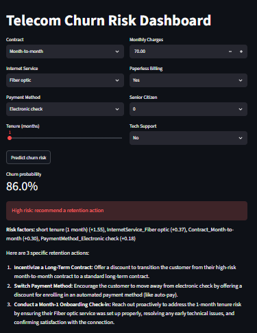
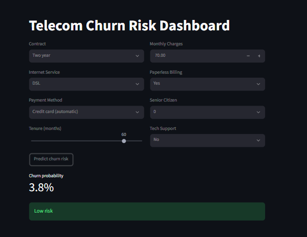

# Telecom Customer Churn Prediction + GenAI Retention Assistant

**Live demo:** https://churn-genai-assistant.streamlit.app

End-to-end ML project that predicts which telecom customers are likely to churn and generates personalised retention actions using Gemini.

## Tech stack
Python, Pandas, Scikit-learn, XGBoost, LightGBM, SHAP, MLflow, FastAPI, Streamlit, Google Gemini

## Dataset
[Telco Customer Churn (Kaggle)](https://www.kaggle.com/datasets/blastchar/telco-customer-churn): 7,043 customers, 26.5% churn. Download the CSV and save it as `data/raw/telco_churn.csv`.

## Results
| Model | ROC-AUC (5-fold CV) | PR-AUC (5-fold CV) |
|---|---|---|
| Logistic Regression | 0.845 | 0.660 |
| XGBoost | 0.843 | 0.666 |
| LightGBM | 0.839 | 0.656 |

Differences are within CV noise, so Logistic Regression was chosen for simplicity and interpretability.
Hold-out test set: ROC-AUC 0.8415, PR-AUC 0.6325.

## Key insights
- Month-to-month contracts: 42.7% churn vs 2.8% for two-year
- Electronic check users: 45.3% churn vs 15-19% for other payment methods
- Churn is concentrated in the first ~10 months of tenure
- Fiber optic customers churn more than DSL
- Per-customer risk factors come from SHAP values on the logistic regression and are passed to Gemini to ground its advice.

## Threshold tuning
A cost-based threshold of 0.35 is used (assumed costs: missed churner = Rs 500, retention offer = Rs 100). These costs are assumptions; the best threshold shifts with them.

## Architecture
Data -> scikit-learn Pipeline -> MLflow tracking -> FastAPI `/predict` -> Streamlit dashboard -> Gemini retention advice

## Run locally
    pip install -r requirements.txt
    python src/train.py
    uvicorn api.main:app --reload
    streamlit run app/streamlit_app.py

Create a `.env` file in the project root with `GEMINI_API_KEY=your_key`.

## Screenshots

## RAG retention assistant
Risk factors (SHAP) are used to retrieve relevant sections from a sample retention playbook (Gemini embeddings + cosine similarity). Gemini then writes actions grounded in the retrieved text and cites the section.
Note: the playbook is sample content written for this project, not a real company document.

## Retrieval evaluation
6 hand-written test queries against the sample playbook: hit rate @3 = 6/6 (100).
Small, hand-made test set, so it is a sanity check, not a benchmark.

## Roadmap
Docker

